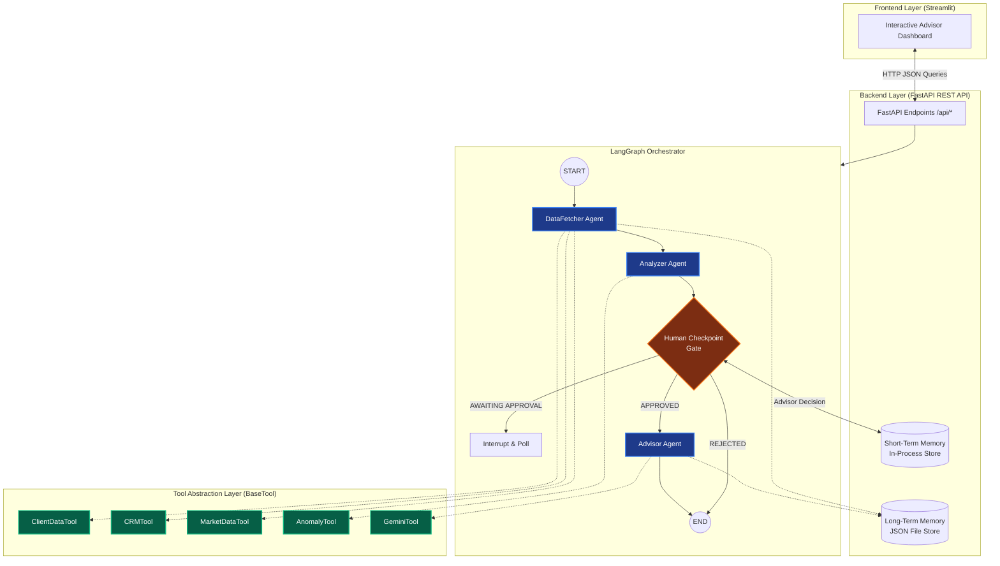

# 💼 Institutional Wealth Advisor Assistant (Multi-Agent System)

An institutional-grade, multi-agent AI system that simulates a senior Wealth Advisor Assistant. The system ingests client financial data, queries simulated CRM and market data APIs, executes statistical anomaly auditing (Z-score, allocation drift, churn detection), and leverages Google Gemini to synthesize structured, actionable wealth advisory recommendations with human-in-the-loop oversight.

Built with **FastAPI** (backend REST API), **Streamlit** (interactive frontend dashboard), **LangGraph** (agent workflow orchestration), and **Google Gemini** (free-tier LLM integration).

---

## 🏛️ Architecture & System Design



---

## 🤖 Agent Roles & Interaction Flow

The system coordinates four specialized agent components through a compiled **LangGraph `StateGraph`**:

| Agent / Node | Primary Responsibility | Tools / Data Used |
| :--- | :--- | :--- |
| **Orchestrator** | Coordinates state transitions, maintains session checkpointer (`MemorySaver`), handles conditional routing, and supports pipeline interruption/resumption. | LangGraph `StateGraph`, `AgentState` TypedDict |
| **DataFetcher Agent** | Ingests client financial records, fetches CRM relationship history, retrieves market benchmarks/quotes, and queries long-term consultation memory. | `ClientDataTool`, `CRMTool`, `MarketDataTool`, `LongTermMemory` |
| **Analyzer Agent** | Audits portfolio allocation vs. risk profile, calculates Z-score anomaly metrics on transaction histories, identifies concentration risks, and produces an audited risk score (0–100). | `AnomalyTool` (statistical formulas) |
| **Human Checkpoint** | **Human-in-the-Loop Gate:** Pauses execution if high-severity anomalies or elevated risk scores are flagged. Allows the advisor to approve, reject, or provide contextual override directives. | `ShortTermMemory`, FastAPI Checkpoint Endpoints |
| **Advisor Agent** | Synthesizes an institutional advisory report using Google Gemini (`gemini-2.5-flash-lite`), integrating portfolio health, anomaly mitigation steps, and advisor override directives. Persists report to long-term memory. | `GeminiTool` (Google GenAI), `LongTermMemory` |

---

## 🛠️ Tool Abstraction Layer

All tools implement the abstract `BaseTool` interface (`backend/tools/base_tool.py`), strictly decoupling agent logic from concrete integrations:

```python
class BaseTool(ABC):
    name: str
    description: str

    @abstractmethod
    def run(self, **kwargs) -> Dict[str, Any]: ...

    def safe_run(self, **kwargs) -> Dict[str, Any]:
        """Encapsulates execution, logs telemetry, and guarantees non-crashing dictionary responses."""
```

- **`ClientDataTool`**: Loads and validates structured client portfolios and transaction history against Pydantic models.
- **`CRMTool`**: Retrieves mock CRM context (KYC status, Relationship Manager notes, life events).
- **`MarketDataTool`**: Returns benchmark index performances (S&P 500, US 10Y Treasury, Cash rate) and ticker quotes.
- **`AnomalyTool`**: Pure statistical calculations (Z-score outliers, concentration thresholds > 25–35%, and rapid sell-off signals).
- **`GeminiTool`**: Connects to Google Gemini API (`google.generativeai`). Operates in real-time mode when `GEMINI_API_KEY` is provided, and gracefully degrades to an intelligent simulated synthesis mode if unconfigured or rate-limited.

---

## 🧠 Memory Architecture (Bonus Feature)

The system features a **two-tier memory architecture**:

1. **Short-Term Memory (`backend/memory/short_term.py`)**:
   - In-process session manager tracking live states, execution logs, and checkpoint decisions.
   - Enables real-time log streaming to the Streamlit UI and manages human approval gates.

2. **Long-Term Memory (`backend/memory/long_term.py`)**:
   - Persisted JSON files stored in `memory_store/{client_id}.json`.
   - Records past consultations, audit scores, anomaly counts, and cumulative pattern notes.
   - Automatically injected into the `AdvisorAgent` prompt for longitudinal context.

---

## 🛡️ Human-in-the-Loop Checkpoint (Bonus Feature)

When the `Analyzer Agent` flags anomalies or a risk score exceeding threshold:
1. The LangGraph graph transitions to `AWAITING_APPROVAL`.
2. The Streamlit dashboard notifies the wealth advisor with detailed findings.
3. The advisor can input notes/override rationale (e.g., *"Client confirmed funds intended for real estate purchase"*) and click **Approve** or **Reject**.
4. The backend resumes graph execution with the human directive embedded into the final advisory report.

---

## ⚖️ Key Decisions & Trade-offs

| Decision | Chosen Solution | Alternative Considered | Rationale & Trade-off |
| :--- | :--- | :--- | :--- |
| **Agent Framework** | **LangGraph** | CrewAI | LangGraph provides explicit state graphs, native state checkpointing (`MemorySaver`), and interrupt/resume flows ideal for deterministic Human-in-the-Loop validation. |
| **Backend Framework** | **FastAPI** | Flask / Django | Asynchronous background task execution, automatic OpenAPI schema documentation (`/docs`), and native Pydantic validation. |
| **Frontend Framework** | **Streamlit** | React / Next.js | Rapid Python development for data dashboards with zero boilerplate; decoupled from backend via HTTP API calls. |
| **Anomaly Detection** | **Pure Statistical (Z-score + Rules)** | Scikit-learn Isolation Forest | Deterministic, explainable audit rules for wealth compliance; zero C-extension installation conflicts. |
| **LLM Tier** | **Gemini 2.5 Flash Lite** | OpenAI GPT-4o | Available in Google AI Studio free tier; fast inference and cost-efficient. Fallback synthesis ensures offline operation. |

---

## 📋 Assumptions Made

1. **Client Identification**: Each client has a unique identifier (`C001`, `C002`, `C003`).
2. **Mock APIs**: CRM and market data feeds simulate realistic external endpoints with structured JSON schemas.
3. **Single Advisor Session**: User operates in an advisory workstation environment with session-based execution.
4. **Resilience**: If any tool or external API experiences an outage, downstream agents continue with partial context rather than crashing.

---

## 🚀 Running the Project Locally

### Prerequisites
- Python 3.11+ (Python 3.11.9 recommended)
- `pip` package manager

### 1. Clone & Set Up Environment

```bash
# Clone the repository
git clone <your-repo-url>
cd glynac_assessment

# Create a virtual environment using Python 3.11
py -3.11 -m venv venv

# Activate virtual environment
# Windows:
venv\Scripts\activate
# macOS / Linux:
source venv/bin/activate

# Install dependencies
pip install -r requirements.txt
```

### 2. Configure Environment Variables (Optional Gemini Key)

Create or edit your `.env` file (copied from `.env.example`):

```env
# Add your free Gemini API key from https://aistudio.google.com/
GEMINI_API_KEY=your_gemini_api_key_here

# Selected model (e.g. gemini-3.5-flash-lite, gemini-2.5-flash-lite, gemini-2.0-flash)
GEMINI_MODEL=gemini-3.5-flash-lite

BACKEND_HOST=127.0.0.1
BACKEND_PORT=8000
FRONTEND_PORT=8501
```

> **Note:** If `GEMINI_API_KEY` is left blank, the system automatically runs in **Simulated Advisory Mode**, executing all agent flows and anomaly audits without failing.

### 3. Run Automated Tests

Verify the entire multi-agent pipeline and API routes:

```bash
# Test full agent orchestrator, tools, anomaly detection, checkpoint, and memory
python test_system.py

# Test all FastAPI REST endpoints using TestClient
python test_api.py
```

### 4. Start the Application

You can launch both services using the provided launcher scripts or separate terminals:

#### Option A: One-Click Launcher (Windows)
Double-click `run_all.bat` or run:
```cmd
run_all.bat
```

#### Option B: Manual Two-Terminal Startup

**Terminal 1 — Backend (FastAPI):**
```bash
venv\Scripts\activate
python -m uvicorn backend.main:app --host 127.0.0.1 --port 8000 --reload
```
*API Swagger Documentation:* [http://127.0.0.1:8000/docs](http://127.0.0.1:8000/docs)

**Terminal 2 — Frontend (Streamlit):**
```bash
venv\Scripts\activate
python -m streamlit run frontend/app.py --server.port 8501
```
*Web Application:* [http://localhost:8501](http://localhost:8501)

---

## 📊 Sample Input & Output Demonstration

### Sample Input (`backend/mock_data/clients.json` — Client C001)
```json
{
  "client_id": "C001",
  "name": "Alice Morgan",
  "age": 45,
  "risk_profile": "moderate",
  "annual_income": 185000,
  "goals": ["Retirement at 60", "Children College Fund (2028)"],
  "portfolio": {
    "total_value": 850000,
    "assets": [
      {"type": "equity", "ticker": "AAPL", "value": 220000, "weight": 0.2588},
      {"type": "bond", "ticker": "UST10Y", "value": 250000, "weight": 0.2941}
    ]
  },
  "transactions": [
    {"txn_id": "T106", "date": "2024-10-02", "type": "sell", "ticker": "MSFT", "amount": 195000}
  ]
}
```

### Audited Anomaly Output (Produced by `AnalyzerAgent`)
```json
[
  {
    "type": "TRANSACTION_SPIKE",
    "severity": "MEDIUM",
    "item_id": "T106",
    "description": "Unusual SELL volume for MSFT of $195,000.00 (Z-Score: 2.04, baseline avg: $47,500.00).",
    "suggested_action": "Verify source of funds and confirm client intent for large capital movement."
  },
  {
    "type": "RAPID_LIQUIDATION_SIGNAL",
    "severity": "HIGH",
    "item_id": "SELL_PRESSURE",
    "description": "Recent sell orders total $207,000.00 (24.4% of total portfolio value).",
    "suggested_action": "Conduct immediate outreach to confirm if client is experiencing unexpected liquidity demands."
  }
]
```

### Advisory Report Output (Synthesized by `AdvisorAgent`)
```markdown
### Wealth Advisory Assessment & Strategic Recommendations

**Executive Summary:**
Client Alice Morgan ($850k AUM, Moderate Risk Profile) is preparing for retirement and college fund obligations. While fixed income allocation remains defensive, recent capital movements reveal elevated churn and single-asset concentration.

**Key Findings & Anomaly Review:**
- T106 SELL order of $195k represents an acute liquidity event (Z-Score 2.04).
- Recent dispositions represent 24.4% of total portfolio value.
- Equity exposure in single-name AAPL (25.9%) exceeds diversified prudential thresholds.

**Recommended Action Plan:**
1. **Immediate Liquidity Clarification:** Contact client to determine if proceeds from the MSFT liquidation are earmarked for short-term liabilities.
2. **Capital Re-deployment:** Allocate remaining proceeds into diversified broad-market ETFs (VTSAX) and intermediate Treasuries (UST10Y).
3. **College Fund Immunization:** Ring-fence $100k in high-yield cash equivalents for the upcoming 2028 matriculation.
```

---

## 📁 Repository Structure

```
d:\glynac_assessment\
├── backend/
│   ├── main.py                  # FastAPI server entry point
│   ├── config.py                # Pydantic Settings configuration
│   ├── logger.py                # Structured loguru logging
│   ├── models/
│   │   ├── client.py            # Client, Portfolio & Transaction Pydantic schemas
│   │   ├── agent_state.py       # LangGraph AgentState TypedDict
│   │   └── responses.py         # API request/response models
│   ├── tools/
│   │   ├── base_tool.py         # BaseTool abstract interface
│   │   ├── client_data_tool.py  # Client data ingestion tool
│   │   ├── crm_tool.py          # Simulated CRM API tool
│   │   ├── market_data_tool.py  # Market benchmarks & quotes tool
│   │   ├── anomaly_tool.py      # Statistical Z-score & heuristic anomaly detector
│   │   └── gemini_tool.py       # Gemini API client with fallback synthesis
│   ├── agents/
│   │   ├── orchestrator.py      # LangGraph workflow, routing & checkpoint manager
│   │   ├── data_fetcher.py      # DataFetcher Agent node
│   │   ├── analyzer.py          # Analyzer Agent node
│   │   ├── human_checkpoint.py  # Human-in-the-Loop review gate node
│   │   └── advisor.py           # Advisor Agent node
│   ├── memory/
│   │   ├── short_term.py        # In-process session state manager
│   │   └── long_term.py         # Persistent JSON historical consultations store
│   ├── mock_data/
│   │   ├── clients.json         # Mock client financial datasets
│   │   ├── crm_data.json        # Mock CRM relationship records
│   │   └── market_data.json     # Mock benchmark indices & quotes
│   └── routes/
│       ├── clients.py           # /api/clients endpoints
│       ├── analysis.py          # /api/analyze & /api/session endpoints
│       ├── checkpoint.py        # /api/checkpoint approve/reject endpoints
│       └── memory.py            # /api/memory endpoints
├── frontend/
│   ├── app.py                   # Streamlit multi-tab dashboard
│   └── utils/
│       └── api_client.py        # Centralized HTTP backend API client
├── memory_store/                # Auto-created client historical JSON stores
├── logs/                        # Auto-created rotating log files
├── test_system.py               # End-to-end multi-agent pipeline test suite
├── test_api.py                  # FastAPI REST endpoints integration test suite
├── requirements.txt             # Pinned Python package dependencies
├── .env.example                 # Environment variable template
├── .env                         # Local environment configuration
├── run_all.bat                  # One-click Windows startup script
├── run_backend.bat              # Backend launcher script
├── run_frontend.bat             # Frontend launcher script
├── run.sh                       # Bash launcher script (macOS/Linux)
└── README.md                    # Project documentation
```
